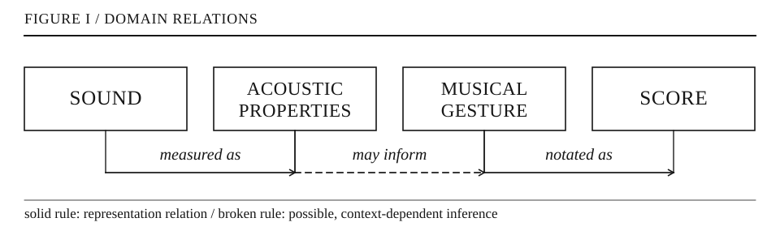
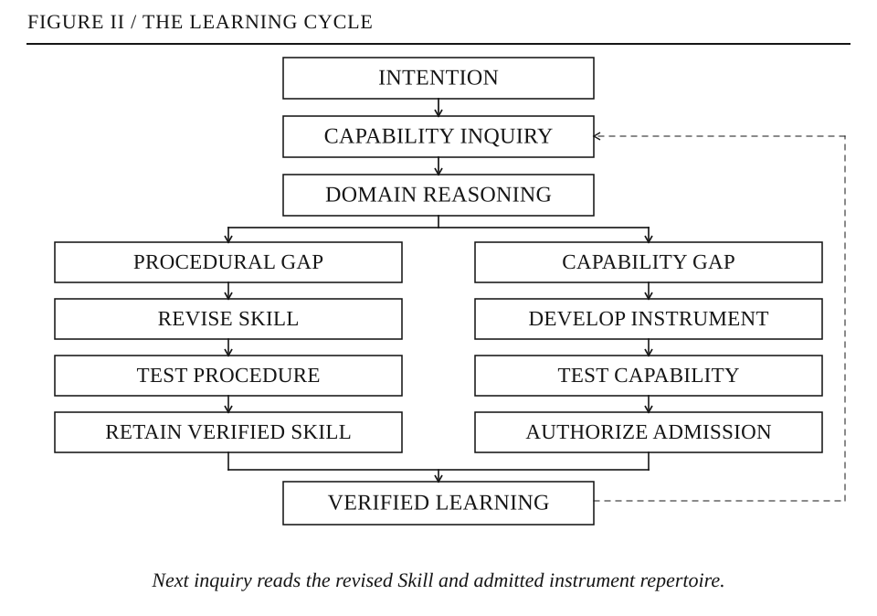
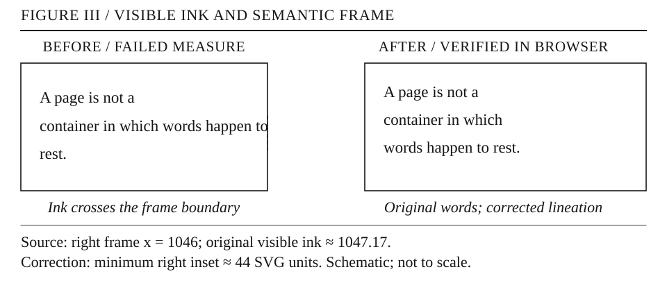

# Before We Can Work Together

*Domain Reasoning, MIDI 2.0 and the Fountain Coach Instruction System*

## Abstract

An AI can invoke a tool without making its capabilities, authority or actual effects intelligible to the person who requested the work. Fountain Coach approaches this problem through a learning instrument ecosystem. Domain Reasoning interprets human intentions through the entities, relationships, constraints and evidence of the domain in which work takes place. MIDI 2.0 makes instrument capabilities discoverable, while FCIS governs their development, admission and execution. Skills preserve reusable knowledge about how work should proceed; instruments provide the executable capabilities through which it is accomplished. Learning forms a continuous cycle of intention, inquiry, reasoning, improvement, verification and renewed inquiry. The system becomes more capable through experience without confusing instructions with abilities or learning with permission.

---

An intelligent instrument should be able to tell us what it can do, while the system in which it participates should be capable of learning what it cannot yet do. **Domain Reasoning is the disciplined interpretation of an intention within a particular domain: its entities, relationships, rules, available evidence and possible consequences.** It establishes what an intended action means before deciding how to accomplish it. Fountain Coach brings this understanding together with MIDI 2.0 and FCIS. We begin with an intention, inquire into the available capabilities and determine the difference between what is possible and what we want to accomplish. That difference may reveal a better way to use existing instruments or the need to develop something new. Once an improvement has been implemented and verified, it becomes available to the next inquiry. Learning is therefore not an activity added to instrument execution; it is the continuing process through which the instrument repertoire and our knowledge of how to use it develop together.

MIDI 2.0 offers an unusually productive foundation for this relationship. Through MIDI-CI, instruments can inquire about one another's capabilities, negotiate supported behavior and exchange structured information. This is more than a convenient way to connect devices. It establishes a conversation in which an instrument can describe aspects of its own abilities instead of leaving another system to guess. When we bring an intention to that conversation, capability inquiry becomes the beginning of learning. We discover not only what can already be accomplished, but also the difference between the available repertoire and the work we intend to perform.

Capability inquiry alone, however, cannot establish what makes an action meaningful. A sound, its acoustic properties, a musical gesture and a written score are different representations of musical experience. Understanding how to move between them requires knowledge of their relationships, not simply commands with suitable names. Domain Reasoning brings that understanding to the inquiry. It relates the intended result to the domain's structure, examines the capabilities of available instruments and identifies the consequences of using them. Only then can we determine whether existing capabilities are sufficient, whether they need to be combined differently, whether the procedure needs improvement or whether a genuinely new capability must be developed.

*Figure I. Relationships between representations in a musical domain. Solid rules denote a descriptive or notational relationship; a broken rule denotes a possible, context-dependent transformation. This plate is conceptual, not a trace of executed instruments.*

**Skills and instruments have different responsibilities within this learning process.** A Skill is a maintained procedure: it describes how to approach a task, which conditions matter, which instruments may be needed and what evidence should establish success. It can preserve corrections and lessons learned from previous work, making them available to subsequent reasoning. An instrument, by contrast, is an implemented capability with an identifiable interface, defined operations and observable execution behavior. The Skill can explain how to publish an essay while preserving its source and illustrations; the publishing instruments actually compose, deliver and verify the edition. The Skill cannot publish by describing publication, and the instrument does not acquire permission to publish merely because a Skill recommends it.

**The learning cycle follows directly from this distinction.** An intention leads to capability inquiry; Domain Reasoning compares the intended result with the available repertoire and identifies the difference. If the instruments are sufficient but the procedure is inadequate, a correction can be developed, tested and retained in the Skill. If the required operation does not exist, an instrument must be implemented or extended, given a typed contract and tested against the intended behavior. FCIS governs the authorization and admission of the resulting capability, while actual execution and its evidence establish whether the intended result was achieved. Verified learning is retained with its provenance and applicable conditions. On the next request, capability inquiry encounters the updated instrument repertoire and Domain Reasoning can draw upon the improved Skills. The cycle begins again from a changed state: not simply another attempt, but an attempt informed by what has demonstrably been learned.

*Figure II. An intention initiates inquiry; reasoning identifies either a procedural gap or a missing capability. A revised Skill or instrument must be verified, and an instrument admitted under authority, before the next inquiry can rely on the result. No automatic admission is implied.*

A concrete example comes from Fountain Press. In the Linotype essay *What Makes a Page Modern?*, an illustration appeared correctly positioned within the page, yet its lettering crossed the boundary of a rectangle drawn inside the illustration. The physical iPad exposed a defect that the existing page-alignment checks had missed. The publishing instruments already possessed the necessary capabilities; what was missing was an adequate understanding of what should be measured. The correction preserved the author's words, changed their lineation inside the diagram and verified the resulting glyph boundaries through browser rendering. The Linotype Skill retained the lesson: visible text must fit within its own semantic frame, not merely within the page containing it. The next time a comparable illustration is composed, this knowledge can guide verification from the beginning. No new instrument was required, and the evidence remains limited to the checks actually performed. The system learned by improving the procedure through which its existing capabilities were used.

*Figure III. Schematic reconstruction, not to scale. Original source measurement: frame right edge x = 1046; visible glyph ink reached approximately x = 1047.17. Corrected lineation retained the words and achieved at least 44 source SVG units of right inset in the browser measurement. The source-bound negative and positive checks are separate from live iPad acceptance.*

This example also shows why failure can be useful without making failure itself a success. An unavailable capability, an unsuccessful test or an execution whose result cannot be established identifies a boundary of current knowledge. It may provide evidence for a proposed correction, but it does not authorize that correction or establish that the system has learned to perform the missing operation. Learning becomes durable only when the relevant change has been verified and appropriately admitted. The system can therefore improve its procedures and extend its repertoire while preserving the distinction between a proposed ability and an available one.

FCIS provides the architecture connecting these responsibilities. A language model may reach FCIS through MCP, interpret an intention and use maintained Skills to guide its approach. Our MIDI 2.0 instrument architecture supplies the means to describe and negotiate capabilities. FCIS governs instrument admission and execution, distinguishing what an instrument declares, what it is authorized to do and what its evidence establishes. FountainStore retains the relevant execution history, provenance and verified learning. Neither a Skill nor a model can manufacture a successful operation through convincing prose; the instrument must perform it, and its result must be established.

This also gives Fountain Coach a deliberate boundary. We do not need to govern every MCP server or absorb every external tool into our architecture. We concentrate on instruments whose capabilities we can understand, develop, maintain and verify. The instrument repertoire may evolve, while Skills evolve alongside it as maintained knowledge about how those capabilities should be employed. Learning is therefore not an uncontrolled expansion of permissions. It is a continuous relationship between intention, procedural knowledge, implemented capability and demonstrated results.

The same distinction shapes our publications. At **fountain.coach**, the essay series explores what it means for machines to understand, learn and act within human domains. At **fcis.fountain.coach**, those ideas acquire technical expression through instrument contracts, governed execution, maintained Skills and durable evidence. The two domains develop one architectural argument from different responsibilities: one examines its meaning, while the other specifies the means by which it becomes operational.

We are not building an AI that already knows how to do everything. We are building an instrument ecosystem capable of discovering its own limits, improving its procedures and extending its executable repertoire. Its invitation is simple: tell us who you are, what you can do and what you intend to do. Then we can work together.