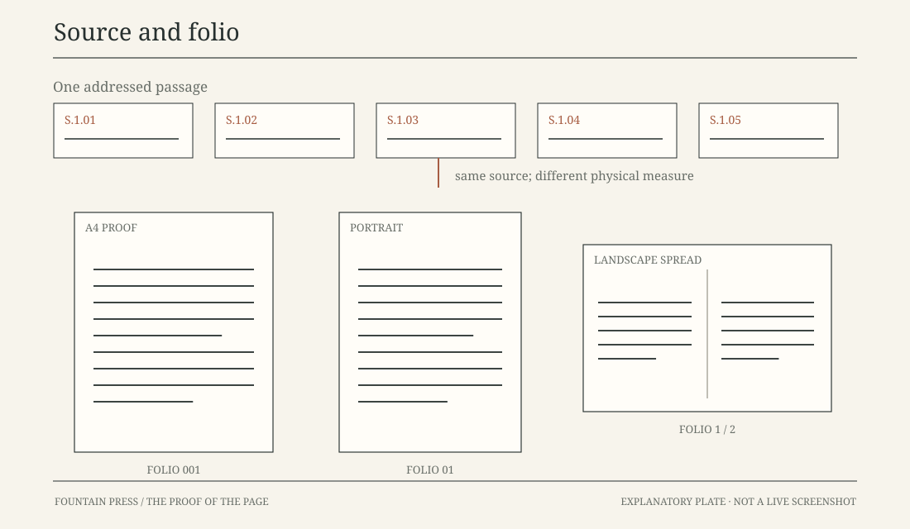
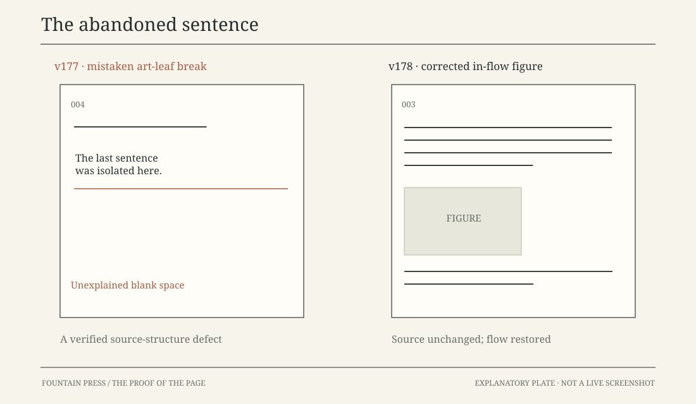
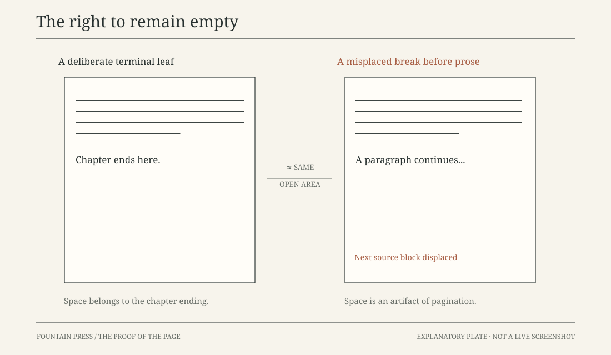
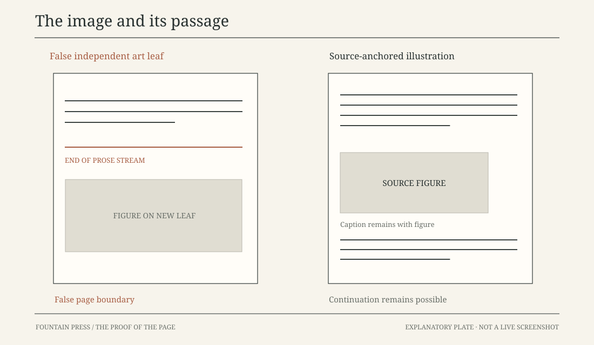
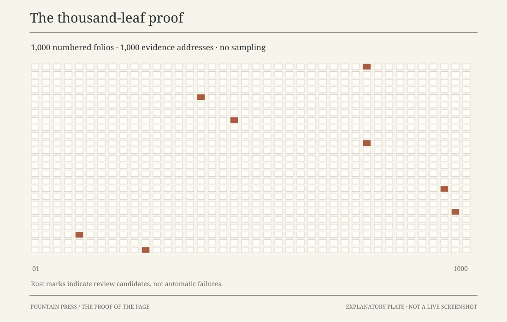
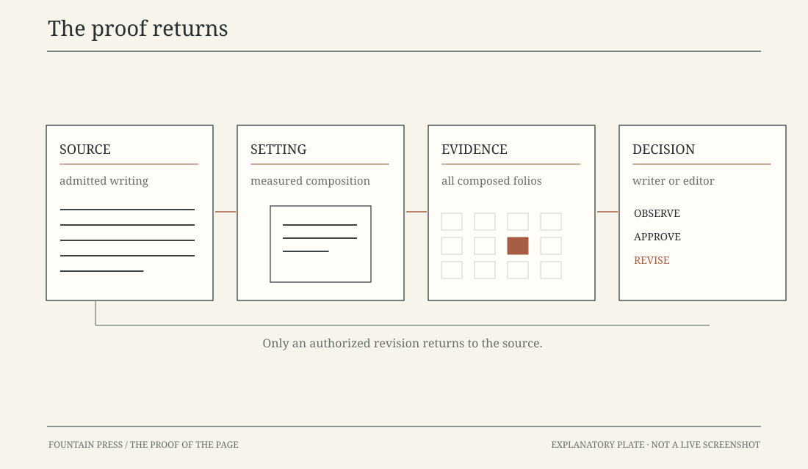

# The Proof of the Page
On composition, judgment, and the thousand-page book

## The sheet returns

A proof comes back from the printer. The text has already been set. It has a measure, a rhythm of lines, a margin wide enough to hold a pencil, and the provisional authority of ink on paper. The writer reads it differently from the manuscript. A paragraph that appeared continuous now breaks across two sheets; a sentence finds itself alone at the foot of a page. Elsewhere a broad interval of white paper makes a thought more intelligible. The printer has produced an object against which a decision can be made.

*What Makes a Page Modern?* approached this object through classical setting, modernist asymmetry, Joyce's returned proofs and a digital page whose words retain their source addresses while its folios change. The question left behind is practical: who examines every composed leaf, and what would count as evidence that a thousand of them have been composed well? A screenshot of the first page cannot answer. Neither can a perfect software test of the paginator. A book does not become a book by succeeding at its opening.

*Plate 01 — Source and setting.* Original schematic. Folio numbers belong to the composition; the passage belongs to its source.

## A sentence abandoned by its page

In a staged edition of *Client-Centered*, an illustration had been given an autonomous art leaf between two fragments of prose. The browser did exactly what the markup required. The fourth folio contained essentially one closing sentence, and almost all the remaining paper was empty. It was not a beautifully restrained pause. It was a broken relationship between a sentence, the figure that followed it, and the next available passage. The compositor could not see that a secondary illustration belonged inside the continuing prose rather than in a new section.

The repair, accepted in the November 10 staging record, restored the original paragraph flow and anchored the figure after its authored paragraph. The manuscript was not shortened, the illustration was not made into a thumbnail, and an arbitrary fill percentage was never introduced. The page was recomposed because the source relationship had been described correctly. That is an instructive distinction: the conspicuous whitespace was evidence, but it was not itself the cause.

*Plate 02 — The abandoned sentence.* Diagram of a verified v177 → v178 structural failure, not a reproduction of the private device screenshot.

## The right to remain empty

Now consider two pages with a similar amount of unoccupied paper. One follows a deliberate title, a short dedication, or the final sentence of a chapter. The other follows a long paragraph that still has readable continuation on the next leaf, displaced because a secondary image was treated as an indivisible block. Their percentages of occupied area may be identical. Their compositions are not.

A Proof Press therefore cannot set a universal density target. It must measure *Format*, *Satzspiegel*, *Stege*, *Zeilenfall* and *Durchschuss*, record the available space, then inspect what the source would permit there. The open page becomes a question: is this interval authored, structurally necessary, or a side effect of a mistaken pagination decision? Some questions have numerical answers. Others need the typographer's eye. A program can identify an exception without claiming the right to erase it.

*Plate 03 — Two kinds of white.* The same quantity of blank paper does not mean the same thing.

## The image belongs to its passage

A figure has more than dimensions. It has a place in an argument. A principal illustration may open a work on a separate plate. A secondary figure may follow a sentence in the same prose stream, with its caption attached and its original aspect ratio intact. In landscape, the figure may occupy the verso while its explanation remains on the recto. In portrait the facing relationship disappears, but the source relationship must survive. The image should neither wander to a convenient vacant rectangle nor demand that the paragraph be rewritten to accommodate it.

This is where page proofing becomes more exacting than checking for overflow. The program must know the figure's source address, verify its caption and artwork, measure the ink within its internal frame, and observe the text before and after it. A reproduced image box can be perfectly aligned while a label drawn *inside the SVG* crosses its own border. One kind of geometry cannot stand in for the other. The corrected WEB READER specimen in *What Makes a Page Modern?* made that distinction visible on the physical iPad: the external figure fitted, but its internal text had exceeded the drawn frame.

*Plate 04 — An image and its passage.* Diagram of an editorial relation, not instructions to maximize page occupancy.

## One thousand leaves

A thousand-page edition is not a large version of the first ten pages. It contains enough line breaks, headings, captions, lists, diagrams, changes of type size and unusual words for a local success to conceal a distant failure. And a browser book is not one fixed thousand-page object. The same admitted writing may require a different number of leaves on an iPad in portrait, an iPad in landscape, a desktop display or a narrow phone. On landscape, two pages may constitute one reading field; in portrait, a single leaf carries the same passage. It would be a mistake to insist that all devices share the same pagination. It would be a worse mistake to inspect only whichever page number happens to be easiest to reach.

The useful machine reads the exact publication catalogue, opens each admitted work in the existing Reader, enumerates every physical leaf on every supported geometry, and records its source intervals and figures, its type-area measurements, its screenshots and the circumstances of the rendering. It checks that each expected folio was encountered exactly once and that no source block vanished. The proof ledger can then show every anomalous heading, clipped caption, broken image or improbable gap with the page's evidence attached. A reader of the ledger can move from a suspicious thumbnail to its actual folio and back to the source. This is a *method of finding what needs attention*, not a claim that a machine has learned to appreciate typography.

*Plate 05 — The thousand-leaf proof.* Schematic of exhaustive enumeration. The marked leaves are examples, not findings from an actual thousand-page run.

## The proof is not the verdict

There are at least three quite different kinds of result. A missing or duplicated source passage is a failure. A caption cut by the type area's edge is a failure. A final page that contains one line is not, by that fact alone, a failure. A heading standing alone before an otherwise continuous paragraph demands investigation; a title leaf standing alone may be precisely correct. These distinctions are not arguments against automation. They tell us what an automated report must be allowed to say.

A measured page can pass its mechanical checks and still need editorial judgment. An exception can be reviewed and accepted without being normalized into a rule for every later edition. The machine should retain the reason for the exception, the exact source and composition revision, and the person who authorized it. When the author changes one paragraph, the previous screenshots become historical evidence rather than the authority for the newly composed pages. The source survives; the folios are set again.

*Plate 06 — The proof returns.* Observations may suggest a new setting; only an authorized revision changes the writing.

## The proof press

It would be tempting to call the instrument a printer because it produces so many pages. Its more modest name is **Proof Press**. The machine gathers an exact edition, visits its leaves in a pinned browser and records what has actually appeared. Its independent auditor refuses incomplete page inventories, changed screenshots or missing addresses. The typographer then reads the exceptional pages, including those that are exceptional only because they are deliberately quiet. The writer chooses whether the writing changes. When it does, the page is composed again and the proof begins from the new source, rather than from a cherished screenshot of the former one.

The old printer's proof was useful because it made a precise temporary object available for disagreement. The digital page can do the same at great scale, provided it does not mistake scale for discernment. A thousand pages can be enumerated without looking like a thousand uniform rectangles; their very differences are what the proof must preserve. The page deserves an examination as careful as the text it carries, and the examination must leave room for the work to continue.

---

*Editorial sources and boundaries.* Companion to *What Makes a Page Modern? — The Printed, Spoken and Addressable Page, and Self Out Loud* (source-owner revision `17e32af`, staging v151/v216). The documented *Client-Centered* illustration/isolated-sentence correction is source `4a89ae5`, private stage v177→v178; the authorial text and image source identities remained stable. Plates 01–06 are newly authored explanatory diagrams, not reproductions of actual failure screenshots. The separate `linotype-proof-press` skill and source-owned page scanner implement a mechanical inventory and measured proof; they do not certify aesthetic quality, literary facts, physical iPad acceptance or public release.
